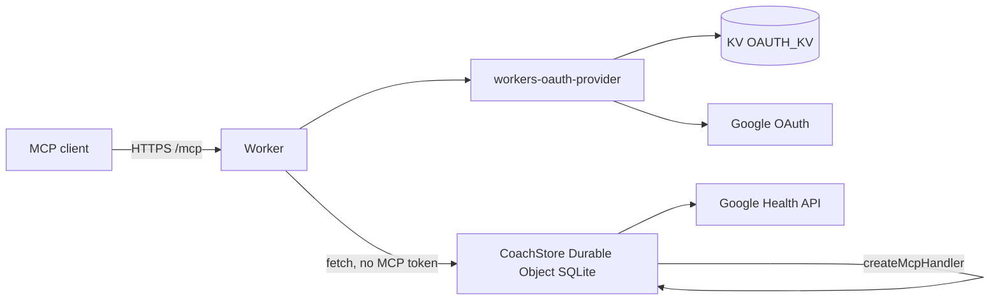
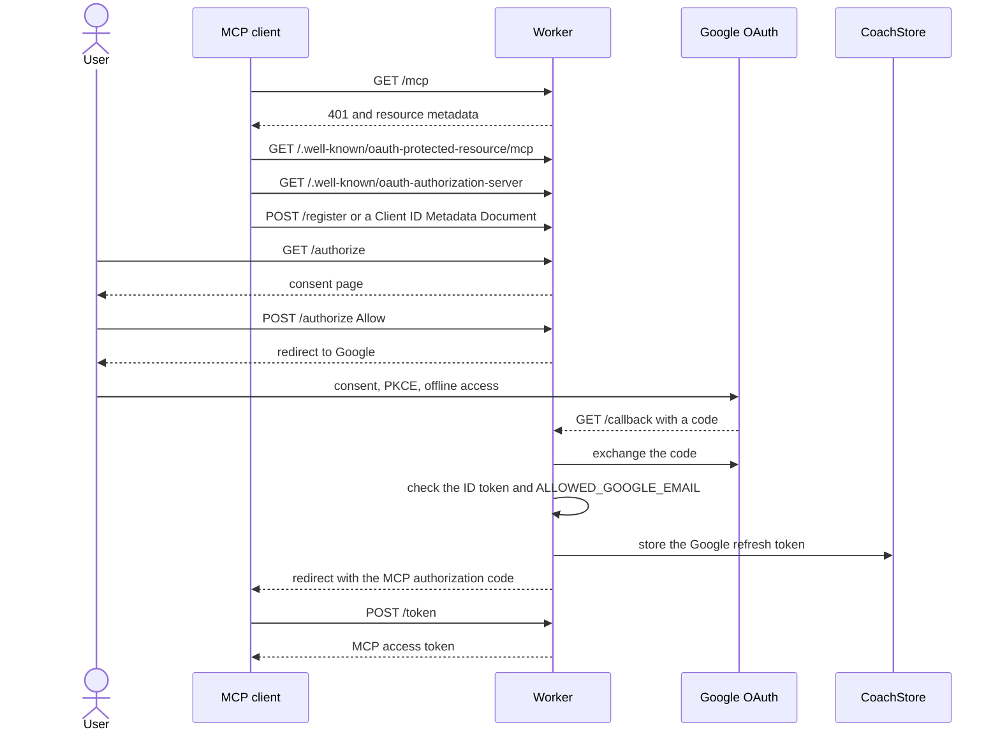
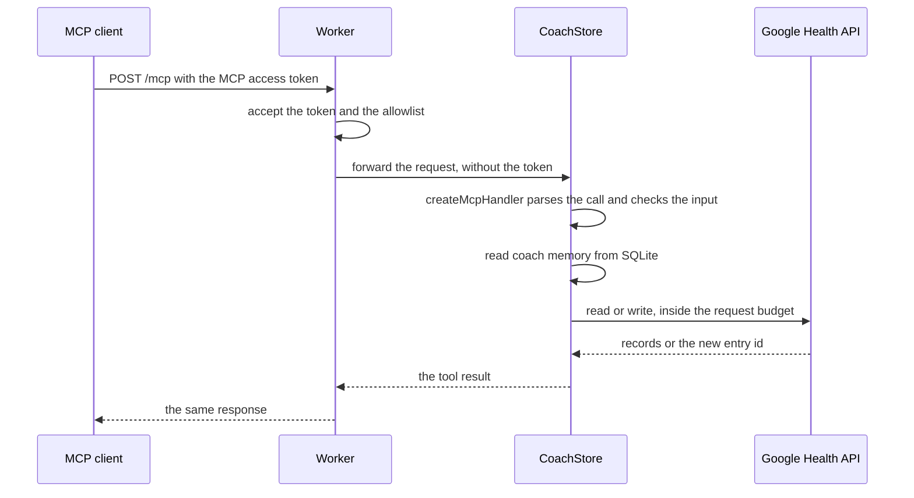

# health-coach-mcp

A remote [MCP](https://modelcontextprotocol.io) server that lets an AI assistant act as a health and fitness coach over your Google Health data (Fitbit or Pixel Watch). It keeps its own coach memory, and it can log meals and completed workouts back to Google Health.

It runs on Cloudflare Workers (Free plan) and is in use. An MCP client such as ChatGPT, Claude or Grok connects to it as a custom connector. The server is single-user: one Google account, named in configuration, is allowed to sign in.

The assistant does the talking. The server does the arithmetic: baselines, deltas, adherence and coverage, so the model is not handed a raw heart-rate series and asked to invent a week. Medical limits travel with the data. The server does not diagnose, and it does not suggest starting, stopping or dosing a medication or a supplement.

Product context is in [`docs/PRODUCT-BRIEF.md`](docs/PRODUCT-BRIEF.md). The tool contract is in [`docs/CAPABILITY.md`](docs/CAPABILITY.md). How the Worker is built, including the Free-plan limits, is in [`workers/README.md`](workers/README.md).

## Features

- **Recovery, training, food and the week.** Morning readiness against your own recent nights, a day's workouts, a day's food log, an ISO week against the week before and the 28 days before that, and a series of one metric.
- **Coach memory.** Profile, versioned targets (kcal, protein, weekly sessions), health history, lab results, preferences and notes the coach can search.
- **Logging back to Google Health.** Add or delete one food entry, and add or delete one completed workout the band did not record. A delete removes only an entry this server created. A logged workout stays a separate record from the band's; when they overlap in time the result says so.
- **Prompts and guardrails.** Four prompts, one per coaching moment, and a `coach://guardrails` resource the answers are told to follow.
- **Your account only.** Google sign-in is checked against an allowlist. Anyone else is refused, and nothing of that sign-in is stored.

## Architecture

One Cloudflare Worker. The OAuth provider sits in front of MCP. Coach memory and the Google link live in one Durable Object with SQLite. OAuth clients, grants and hashed MCP tokens live in KV. The Google refresh token does not.



`createMcpHandler` runs inside `CoachStore`, so a tool reads SQLite directly. The Worker isolate only checks the caller and forwards the request. Google Health calls share one request budget for that HTTP request.

### Linking a Google account

The MCP client is the OAuth client. Google is the identity provider. The allowlist is checked before anything is stored.



A Google account that is not the allowlisted one gets a 403 page. Its Google token is revoked, and no grant is created. The MCP grant carries `{ sub, email }` only.

### One tool call



A tool error is JSON `{ code, message, hint }` in the text content, with `isError` set and no structured content. The log line is the tool name, the duration and the outcome.

## Tools

The server registers 22 tools (`createServer` in `workers/src/mcp.ts`).

### Reachability

| Tool | What it does |
|---|---|
| `server_info` | Returns the server name, version and transport, to check that the coach is reachable. |
| `google_account_status` | Shows the linked Google account, the Google Health scopes it granted or is missing, and whether an access token can be obtained. It never returns a token. |

### Coach memory

| Tool | What it does |
|---|---|
| `profile_get` | Returns the profile, the targets in force, active health history and preferences. |
| `profile_update` | Updates the profile with the fields you send. |
| `targets_set` | Records a new version of the daily kcal, protein and weekly session targets, after the user confirms the numbers. |
| `health_item_upsert` | Adds or updates a condition, medication, supplement, injury, allergy or dietary restriction. |
| `health_items_list` | Lists health history, optionally filtered by kind and status. |
| `labs_record` | Stores lab results from one collection date, each with a status against the range on its own report. |
| `labs_query` | Returns lab results as one series per analyte, oldest first. |
| `preference_set` | Stores one preference as JSON under a short key. |
| `preferences_get` | Returns every stored preference. |
| `note_add` | Saves a coach note: an insight, a decision, a check-in, or a symptom the user reported. |
| `notes_search` | Finds coach notes, newest first. A query matches whole words. |

### Coaching moments

These five read Google Health. They compare a day or a week with the user's own baseline and say how many days that comparison rests on.

| Tool | What it does |
|---|---|
| `morning_briefing` | Sleep, overnight HRV and resting heart rate against the recent baseline, yesterday's training load, and a readiness level. |
| `workout_review` | The workouts of one day, or one session, the ISO week against the sessions target, and the night after. |
| `nutrition_day` | One day's food log against the kcal and protein targets, with protein per kilogram and the energy balance when it can be shown. |
| `weekly_report` | An ISO week against the previous week and the 28 days before it: weight, body fat, resting heart rate, HRV, sleep, steps, adherence and the week's decision notes. |
| `metric_series` | Daily or weekly values of one metric over a range of at most 366 days and at most 180 points. |

### Logging to Google Health

| Tool | What it does |
|---|---|
| `nutrition_log_add` | Logs one meal or food item in Google Health, with the calories and macros the client estimated, and returns `entry_id`. |
| `nutrition_log_delete` | Deletes one food entry, and only an entry this server created. |
| `exercise_log_add` | Logs one completed workout the band did not record, and returns `entry_id`. |
| `exercise_log_delete` | Deletes one workout session, and only a session this server created. |

`nutrition_day` and `workout_review` repeat that `entry_id` on the item or session, so a later chat can delete it. An item or session this server did not create has `entry_id` null.

## Prompts and guardrails

Four prompts, registered in `workers/src/prompts/index.ts`:

| Prompt | Tool it runs |
|---|---|
| `morning_briefing` | `morning_briefing` |
| `nutrition_review` | `nutrition_day` |
| `workout_review` | `workout_review` |
| `weekly_report` | `weekly_report` |

Each prompt tells the model to call `profile_get`, then that tool, then to follow the task for the moment. The guardrails are inlined in the prompt. An optional day (`date`, or `week_end` for the week) is parsed as a calendar date before it reaches the text.

The resource `coach://guardrails` (`workers/src/prompts/guardrails.ts`) is the same rules as a markdown document: medical limits, eating and training load, how to read the numbers, and tone. Every coaching answer is told to follow them.

## Data and privacy

One person. `ALLOWED_GOOGLE_EMAIL` is the only Google account that may finish sign-in or call `/mcp`. The check runs again on every MCP request and when an MCP token is refreshed. Another account is shown a refusal page; its Google token is revoked and nothing is saved. The pages never name the allowed account.

Scopes requested at Google sign-in (`GOOGLE_SIGN_IN_SCOPES` in `workers/src/google.ts`):

- `openid` and `email`, to identify the account and check the allowlist
- `googlehealth.activity_and_fitness.readonly`
- `googlehealth.health_metrics_and_measurements.readonly`
- `googlehealth.sleep.readonly`
- `googlehealth.nutrition.readonly`
- `googlehealth.nutrition.writeonly`, for `nutrition_log_add` and `nutrition_log_delete`
- `googlehealth.activity_and_fitness.writeonly`, for `exercise_log_add` and `exercise_log_delete`

What is stored where:

| Place | What |
|---|---|
| `CoachStore` (Durable Object SQLite) | Profile, targets, health items, labs, preferences, notes, the `daily_metrics` cache, the Google account link (including the refresh token), and the ids of food entries and workouts this server created |
| `OAUTH_KV` | OAuth clients, grants and hashed MCP tokens. Not the Google refresh token |
| Google Health | The user's health data. This server reads it, and writes only the food entries and workouts its tools create |

The cache of daily values is disposable: the source of truth for those numbers is Google Health. A sign-in of a different Google account clears that cache. Coach memory stays; it is the person's, not the band account's. Food and workout rows stay too, and count again only when their account is linked.

A public home page at `/` and a privacy policy at `/privacy` are served without sign-in, for the Google OAuth consent screen. They do not include health data.

## Limits on the Free plan

The design is sized for the Workers Free plan: one SQLite-backed Durable Object and one KV namespace. CPU, subrequests, Google Health rate limits, and what a large call does when it runs out of requests are written up in [Workers Free plan](workers/README.md#workers-free-plan). That section is the one to read; this page does not repeat it.

## Run locally

From `workers/`. Wrangler requires Node `>=22.12.0`.

```bash
cd workers
npm ci
cp .dev.vars.example .dev.vars
```

Fill in `.dev.vars` (it is gitignored):

- `GOOGLE_CLIENT_ID` and `GOOGLE_CLIENT_SECRET` from a Google OAuth client of type **Web application**
- `ALLOWED_GOOGLE_EMAIL`, the one account that may sign in

Authorized redirect URI for local runs: `http://localhost:8788/callback`.

```bash
npm run dev
```

The MCP endpoint is `http://localhost:8788/mcp`. The [MCP Inspector](https://github.com/modelcontextprotocol/inspector) can connect to it and run the OAuth flow in the browser:

```bash
npx @modelcontextprotocol/inspector@latest
```

## Test

From `workers/`:

```bash
npm test
npm run typecheck
```

The tests run in workerd. They mock every Google call and use synthetic values. Nothing calls Google or Cloudflare.

`test/fixtures/go-tools-list.json` and `test/fixtures/go-prompts.json` are a frozen snapshot of the former Go server. They are the source of truth for the parity tests. The repository does not regenerate them.

## Deploy your own instance

From `workers/`, after `npx wrangler login` in the Cloudflare account where the Worker should live. You need your own Google Cloud project and OAuth client, your own KV namespace, and the one Google account that may sign in. This repository does not include a Cloudflare account id, a Google project id, a real KV namespace id, or an account address.

The committed KV id in `wrangler.jsonc` is a placeholder, so tests and `wrangler types` have a value. Replace it with the id of the namespace you create. Do not commit a real id if you do not want it public.

1. In Google Cloud console, create an OAuth client of type **Web application**.
   - Authorized redirect URI: `https://<your-worker>.workers.dev/callback`
   - For local runs, also `http://localhost:8788/callback`
   - While the consent screen is in **Testing**, add the account as a test user. Google expires refresh tokens of Testing apps after 7 days.
   - Enable the Google Health API scopes the server requests, including the two write scopes.
2. Create a KV namespace and set its id on the `OAUTH_KV` binding in `wrangler.jsonc`:
   ```bash
   npx wrangler kv namespace create OAUTH_KV
   ```
3. Set the three secrets:
   ```bash
   npx wrangler secret put GOOGLE_CLIENT_ID
   npx wrangler secret put GOOGLE_CLIENT_SECRET
   npx wrangler secret put ALLOWED_GOOGLE_EMAIL
   ```
4. Deploy:
   ```bash
   npm run deploy
   ```

Add `https://<your-worker>.workers.dev/mcp` as a custom connector in the MCP client. The client registers itself; you do not give it the Google client id.

`HCM_TZ` in `wrangler.jsonc` is the IANA zone that defines a day (default `America/Sao_Paulo`). `Local` and unknown names are rejected.

## Project layout

```
workers/          the server: source, tests, wrangler.jsonc
  src/            Worker, OAuth, CoachStore, Google Health client, tools, prompts
  test/           vitest, including the frozen contract fixtures
docs/             product brief and the capability contract
plans/            the original implementation plan, kept as history
NOTICE            Apache-2.0 attribution for the adapted Google Health client
```

## License

This repository has no top-level license file.

`workers/src/googlehealth/client.ts` and `workers/src/googlehealth/datatypes.ts` are adapted from [google-health-cli](https://github.com/Google-Health-API/google-health-cli), Copyright 2026 Google LLC, Apache License 2.0. Those files keep the original license header. `NOTICE` lists them.
